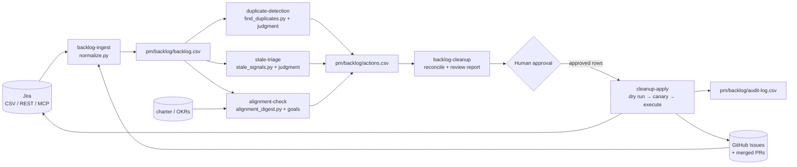

# Backlog Hygiene with AI Agent Skills

### Why stale, duplicate, and misaligned tickets matter, what these skills do about them, and how to put them to work

**Audience:** project managers, product owners, scrum masters, engineering managers, PMO and portfolio leads, and open-source maintainers who run work through Jira or GitHub Issues.
**Scope:** the six skills in this repository: `backlog-ingest`, `stale-triage`, `duplicate-detection`, `alignment-check`, `backlog-cleanup`, `cleanup-apply`.

---

## Summary

Every tracker accumulates tickets that no longer describe real, wanted, unique work. Some are **stale**: abandoned, finished but never closed, or orphaned when their owner left. Some are **duplicates**: the same problem filed twice, often in different words or in different tools. Some are **misaligned**: valid-looking work that no longer serves the project's goals, or important work that has no place in the plan. Together they form *backlog debt*.

Backlog debt is not just cosmetic. It distorts forecasts, dilutes priority, causes duplicate effort, hides risks, and erodes the team's trust in the tool until people start keeping the real plan somewhere else. Teams know this. The cleanup still rarely happens, because doing it properly means reading hundreds of tickets with judgment, and the shortcuts (time-based stale-bots, "backlog bankruptcy" mass closes) throw away good work along with the bad.

AI agents are now good at exactly the step that used to need a person: reading a ticket, its comments, its links, and the project's goals, then saying what is going on and why. These skills pair that judgment with deterministic scripts that find candidates cheaply, and with a strict human-approval and audit process that keeps every change reversible. The result is a review a product owner can approve in one sitting, which used to take a team several refinement sessions or never happened at all.

---

## 1. The problem: backlog debt

### Three forms

| Form | What it is | How it typically arises |
|---|---|---|
| **Stale** | Tickets that no longer represent live work: abandoned, stuck "In Progress", finished but never closed, owned by someone who left, blocked by something long since resolved | Creating a ticket is cheap and closing one is socially awkward; work ships through a PR that never references the ticket; people change teams; sprints carry work forward by default |
| **Duplicate** | Two or more tickets for the same problem or deliverable | Several intake channels (support, sales, engineers, customers); different vocabulary for the same symptom; Jira *and* GitHub both used as front doors; search that only matches keywords |
| **Misaligned** | Tickets that don't trace to any current goal (or contradict the stated scope), plus important tickets with no epic, owner, or priority that would put them in the plan | Goals and scope change faster than the backlog is revisited; features get retired but their tickets linger; pet projects get high priorities; urgent findings (security, legal) arrive outside the planning process |

### Why backlogs rot

Backlogs rot because the incentives are lopsided. Adding a ticket takes seconds and feels responsible. Removing one takes reading, judgment, and sometimes an awkward conversation with the person who filed it. Nobody is accountable for the backlog as a whole, so the default outcome is accumulation. Lean thinking has a name for this: **inventory**. Unfinished work sitting in a queue has a carrying cost even though nobody sees an invoice for it. Donald Reinertsen's *The Principles of Product Development Flow* makes the case in detail: product development queues are invisible, so organizations consistently underestimate what they cost.

---

## 2. Why it matters: the costs

### 2.1 Forecasts become fiction

Forecasting work is, at its core, dividing remaining work by throughput. Little's Law, the queueing result behind most flow metrics, says the average time an item spends in a system equals the number of items in it divided by the rate at which items leave (W = L / λ). If the "items in the system" include tickets nobody will ever do, every forecast built on that count is inflated, and so is every lead-time figure.

*Illustrative example (hypothetical numbers):* a team has 600 open tickets and closes about 50 a month. The naive forecast for clearing the backlog is 12 months. If 200 of those tickets are dead, duplicated, or out of scope, the real figure is 400 tickets, or 8 months. The four-month difference is not a rounding error. It decides whether a roadmap commitment looks feasible, whether a team asks for headcount, and whether a sponsor trusts the next estimate.

### 2.2 Priority stops carrying information

When everything old is still "High", priority means nothing. Duplicates make it worse in a subtler way: demand for one problem gets split across two or three tickets, so each looks less important than it is. Three customers reporting the same bug in three tickets should be one ticket with three customers on it.

### 2.3 Duplicate effort and lost knowledge

Two engineers fixing the same bug from two tickets is the obvious cost. The less obvious one is lost context: the repro steps live on ticket A, the affected customer on ticket B, and the workaround in a comment on ticket C. Whoever picks up any one of them works with a third of the information.

### 2.4 Effort goes to work that doesn't count

Strategy is executed through the backlog. When a meaningful share of active tickets traces to no current objective, the team is busy without moving the goals. This is a large part of the well-known gap between strategy and execution, and it is invisible unless someone traces tickets back to goals. Traceability is a classic tool of project scope management (the *requirements traceability matrix* in PMI's PMBOK Guide), but it is rarely kept up for a living backlog because doing it by hand is tedious.

### 2.5 Risks hide in plain sight

The most expensive tickets in a messy backlog are often the high-stakes ones that fell through a crack: a penetration-test finding assigned to someone who left, a legal deadline with no epic and so absent from planning, a customer commitment buried under a hundred cosmetic issues. Clutter hides them. Cleaning up surfaces them, which is often worth more than the cleanup itself.

### 2.6 Metrics lie

Ticket age, cycle time, throughput, cumulative flow, "bugs open": all of these are computed from the tracker. Zombie "In Progress" tickets inflate work-in-progress and cycle time; done-but-open tickets understate throughput; duplicates inflate defect counts. Leadership dashboards inherit every one of these distortions.

### 2.7 Trust erodes, and the plan moves elsewhere

Once people believe the tracker is a graveyard, they stop searching it (so they file more duplicates), stop updating it (so more tickets go stale), and keep the real plan in spreadsheets, chat threads, and private notes. That is the end state to prevent: the system of record stops being the record, and every coordination problem gets harder.

### 2.8 Onboarding and search costs

Every new team member, stakeholder, or contractor who searches the backlog pays a tax on every dead ticket they have to read and dismiss. The tax is small per ticket and large in aggregate.

---

## 3. Why current approaches fall short

| Approach | What it does well | Where it fails |
|---|---|---|
| **Manual backlog refinement** | Real judgment; team context; the Scrum Guide treats refinement as an ongoing activity | Doesn't scale past a few hundred tickets; refinement time goes to the top of the backlog, so the long tail never gets reviewed; tedious, so it gets skipped |
| **Time-based stale-bots** (close after N days of inactivity) | Cheap, automatic, consistent | Time is the weakest signal. They close valid known bugs and long-lead items, miss dead tickets that a bulk edit recently "touched", and can't tell *done* from *abandoned*. Reporters experience them as being ignored |
| **Built-in "similar issues" / keyword dedupe** | Catches near-identical titles at creation time | Misses duplicates worded differently and duplicates across tools; doesn't decide which ticket to keep or carry information over |
| **Automation rules** (e.g. "close if parent closed") | Precise for the cases they encode | Brittle; each rule handles one pattern; no reading of content or comments |
| **Backlog bankruptcy** (close everything older than X) | Fast reset | Throws away real bugs and commitments along with the rot; teaches people that the backlog doesn't matter; the rot comes back because nothing upstream changed |

The common gap is **judgment at scale**: reading each ticket in context and deciding what is actually going on, for hundreds of tickets, without a person spending days on it.

---

## 4. What AI changes, and what it should not change

### What changes

A capable AI agent can do the reading part of triage:

- **Read the whole ticket**, not just its dates: description, last comments, links, parent, and linked pull requests. "Deployed on Friday", "no longer needed after the redesign", and "+1, still happening for us" are plain text an agent can understand.
- **Match meaning, not words.** "SSO login fails on Safari" and "Okta redirect loop on Mac" are recognizably the same bug.
- **Work across tools.** A Jira story and a GitHub issue describing the same feature can be spotted and merged with a cross-reference.
- **Compare work against goals.** Given a charter or OKRs, an agent can say which objective a ticket serves (or that it serves none), and quote the out-of-scope line it conflicts with.
- **Write the human part.** Closing comments that explain why and how to object, and questions that name a person and a date, so the cleanup reads as stewardship rather than a bot sweep.

### What should not change

Decisions about other people's work stay with people. These skills are built on a few rules that are not negotiable:

1. **Recommend, never decide.** Every change is a row in `actions.csv` that a human approves.
2. **Deterministic first, judgment second.** Scripts compute signals and candidates cheaply and reproducibly. The AI judges the candidates and cites its evidence. Neither replaces the other.
3. **Evidence or it didn't happen.** Every proposed action carries a reason a reporter would accept ("PR #211 merged 2026-08-20"), and a confidence level.
4. **One decision per ticket.** When passes disagree (stale vs. duplicate), a precedence rule produces one coherent action.
5. **Reversible by construction.** Nothing is deleted. Closes carry resolutions, links, and comments. Every change is logged with its previous state and an undo hint.
6. **Never overwrite newer reality.** If a ticket changed after the snapshot, it's skipped and re-triaged, not overwritten.
7. **High-stakes work is escalated, never closed as stale.** That covers security, legal, compliance, safety, and customer commitments.
8. **Ticket text is data, not instructions.** Content inside tickets can't direct the agent.

---

## 5. How the skills work



| Skill | Role | Deterministic part | Judgment part |
|---|---|---|---|
| **backlog-ingest** | One snapshot from Jira and/or GitHub | `normalize.py`: Jira CSV (repeated columns), Jira REST/MCP JSON, `gh` JSON → one schema | Scope, sanity checks |
| **stale-triage** | Stale, zombie, done-but-open, orphaned work | `stale_signals.py`: 10 weighted signals incl. merged PRs referencing tickets | Classify each candidate; write the comment |
| **duplicate-detection** | Same work filed twice, including across tools | `find_duplicates.py`: TF-IDF similarity, clustering, parent/child and existing-link handling | Duplicate vs. overlapping vs. related; choose canonical; carry details over |
| **alignment-check** | Work vs. goals and scope | `alignment_digest.py`: epic-grouped digest; structural flags | Map tickets to objectives; out-of-scope; misplaced or homeless high-stakes work |
| **backlog-cleanup** | End-to-end review | — | Sequencing, conflict resolution, report, health metrics |
| **cleanup-apply** | The only skill that writes | `apply_actions.py`: validation, dry run, canary, freshness check, audit, undo hints | Approval handling; MCP path |

All scripts use only the Python 3 standard library, so there is nothing to install beyond Python and, for GitHub, the `gh` CLI. The skills follow the Agent Skills `SKILL.md` format, so they work in Claude Code and other agents that support it. They share a `pm/` workspace with the companion [ProjectManagementSkills](https://github.com/Mehakkapoor14/ProjectManagementSkills) repository, so a charter written by `project-charter` becomes the goals that `alignment-check` measures against.

---

## 6. Impact in the project management domain

### 6.1 By role

| Role | What changes for them |
|---|---|
| **Project / program manager** | Forecasts built on real remaining work; a traceability view (objective → tickets) without maintaining a matrix by hand; unowned high-stakes items surfaced for the RAID log |
| **Product owner** | Refinement time spent deciding, not reading; demand consolidated onto canonical tickets so priority reflects reality; out-of-scope requests closed with a clear, citable reason |
| **Scrum master / agile coach** | Zombie WIP and chronic carry-over made visible as process signals (WIP limits, overcommitment) rather than individual failings |
| **Engineering manager** | Less duplicate effort; done-but-open tickets closed from merged-PR evidence; orphaned work from departed staff reassigned deliberately |
| **PMO / portfolio lead** | A repeatable, comparable health review across projects with the same metrics, so "backlog health" becomes something you can report on |
| **Support / operations lead** | Customer-reported duplicates merged with customers listed on one ticket; reporters told where their issue went |
| **Open-source maintainer** | A stale-bot that reads: closes what's fixed or answered, asks before closing what's unclear, and leaves valid old bugs open |

### 6.2 By project management practice area

| Practice area (PMBOK terms) | Contribution |
|---|---|
| **Scope management** | Out-of-scope detection against the charter; traceability from objectives to tickets; early warning of scope creep (clusters of new tickets in an out-of-scope area) |
| **Schedule management** | Forecasts based on live work; unblocked-but-forgotten tickets surfaced (`blockers_resolved`) |
| **Risk management** | Unowned security/legal/compliance items escalated; systemic causes (offboarding gaps, intake without templates) reported as process risks |
| **Stakeholder & communications** | Every closure explains itself to watchers; questions name a person and a date; reporters aren't silently ignored |
| **Quality management** | Duplicate defects consolidated, so defect counts and severity reflect reality |
| **Integration & change control** | Changes are proposed, approved, executed, and audited: a lightweight change-control loop for the backlog itself |

### 6.3 A worked example (the bundled sample backlog)

The `examples/` folder contains a synthetic "Customer Portal Relaunch" backlog: 20 Jira tickets, 8 GitHub issues, 3 pull requests, and a goals excerpt. Problems were planted in it on purpose. Running the scripts (see the README's quick start) produces candidates that the judgment step turns into these findings:

- **Done but never closed:** PORT-17 ("Upgrade payment SDK to v5") has sat "In Progress" for 84 days, but PR #211, which *resolves PORT-17*, merged in August. GitHub #105 was fixed by merged PR #210 but is still open.
- **Duplicates, one of them across tools:** PORT-12 / PORT-13 (the same Okta-on-Safari redirect loop, worded differently); GitHub #101 / #102 (the same checkout button bug); and a three-way cluster where Jira PORT-10 and PORT-11 and GitHub #103 all describe invoice PDF download.
- **Misaligned:** PORT-14 and PORT-15 belong to a dashboard retired in June (closed epic PORT-3, out of scope per the goals); PORT-16 belongs to a mobile app the charter defers to FY27; GitHub #106 asks for IE11 support, which is explicitly out of scope.
- **The findings that matter most:** PORT-18, a pen-test finding that must close before a SOC 2 audit, is assigned to an inactive person and has no epic, so it is invisible in planning. PORT-27, a GDPR data-export obligation, is past its legal deadline and also has no epic. PORT-21 has been unblocked since its blocker closed in September, and nobody noticed.

A time-based stale-bot sees PORT-17 (84 days idle) and PORT-18 (162 days idle) as the same kind of ticket and closes both. One closure loses the record that the upgrade shipped; the other quietly drops a security finding weeks before an audit. Judgment separates them: PORT-17 is *done* and gets closed with the PR as evidence, while PORT-18 is *valid and unowned* and gets escalated to a named person with a date.

---

## 7. Measuring impact

Measure two things: the health of the backlog, and the quality of the agent's recommendations. The `backlog-cleanup` report template tracks the first set every review, so trends show up over time.

### Backlog health

| Metric | Definition | Healthy direction |
|---|---|---|
| Open tickets | Count of open tickets in scope | Stable or falling relative to throughput |
| Median age of open tickets | Days since creation | Falling |
| Untouched > 90 days | Share of open tickets with no update or comment in 90 days | Falling |
| Zombie WIP | In-progress tickets idle > 14 days | Near zero |
| Done-but-open | Open tickets referenced by a merged closing PR | Zero |
| Confirmed duplicate pairs | Per review | Falling (fewer re-filings) |
| Traceable to an objective | Share of open tickets that map to a goal | Rising |
| Unowned high-priority | High/Highest tickets with no assignee or epic | Zero |
| Forecast stability | Change in "months to clear backlog" between reviews that isn't explained by new scope | Smaller swings |

### Recommendation quality

| Metric | Definition | What it tells you |
|---|---|---|
| **Approval rate** | Approved rows ÷ proposed rows | Low means the thresholds or judgment are off for this team; tune before scaling up |
| **Reopen rate** | Tickets closed by cleanup that are reopened within 60 days | The false-positive rate; should be very low. Any reopen is worth a look |
| **Time to review** | Human time from report to approved `actions.csv` | The time saved compared with manual refinement |
| **Skip rate** | Skipped (changed since snapshot) ÷ executed | High means reviews take too long between snapshot and apply |

Record a baseline from the first read-only review before changing anything. Without a baseline, impact claims are guesses.

---

## 8. Adoption playbook

**Week 0: install and dry-run on the example.** Install the skills (see the README), then run the quick start on `examples/` to see the outputs without touching real data.

**Week 1: read-only review.** Run `backlog-cleanup` on one real project. Share the report with the product owner and team leads. Change nothing. Agree on: the inactive-people list, the "deliberately parked" labels, a "do-not-close" label for anything people want protected, and the goals document. Record the baseline metrics.

**Week 2: small, high-confidence batch.** Approve only high-confidence `done` and `duplicate` closes. Announce in the team channel that the cleanup is happening and how to object (reopen, or reply on the ticket). Run the canary (`--limit 1`), check it in the tool, then run the batch.

**Weeks 3–4: the harder decisions.** Bring alignment findings and "needs owner" items to a refinement or planning session. These are product decisions, not cleanup. Put unowned high-stakes items in the RAID log.

**Ongoing: cadence and prevention.** Re-run the review each sprint or monthly. Previous `keep` decisions carry forward, so the same tickets aren't re-litigated. Fix the systemic causes the reports name: "Fixes KEY" in PR titles, ticket hand-over in offboarding, intake templates, a single front door for requests. Optionally schedule the review to run automatically and post its report; approval and apply stay manual.

**Scale out:** once approval rate is high and reopen rate is near zero on one project, roll out to others, keeping the same metrics so a PMO can compare across projects.

---

## 9. How to use it

### Install

```bash
git clone https://github.com/Mehakkapoor14/StaleTaskAgent.git
# all projects
cp -r StaleTaskAgent/skills/* ~/.claude/skills/
# or one project
mkdir -p .claude/skills && cp -r StaleTaskAgent/skills/* .claude/skills/
```

For other Agent Skills–compatible agents, copy the folders under `skills/` into that agent's skills directory.

Requirements: Python 3.9+. For GitHub, the `gh` CLI, authenticated (`gh auth login`). For Jira, one of: a CSV export, an API token (`JIRA_URL`, `JIRA_EMAIL`, `JIRA_API_TOKEN`; or `JIRA_PAT` on Data Center), or Atlassian MCP tools connected to your agent.

### Things to ask the agent

- "Run a backlog cleanup review for Jira project PORT and the acme/portal-web repo. Goals are in pm/charter.md. Dana Lee has left."
- "Which of our open GitHub issues are already fixed by merged PRs?"
- "Find duplicates in this Jira export, including ones worded differently."
- "Does our backlog match the Q1 OKRs? Here they are: …"
- "Is there already a ticket for 'users can't reset password on mobile'?"
- "Apply the approved actions. Canary first."
- "Undo yesterday's cleanup for PORT-14."

### Running the scripts directly

Each `SKILL.md` documents its script's arguments. The bundled example end to end:

```bash
mkdir -p pm/backlog
python3 skills/backlog-ingest/scripts/normalize.py examples/jira-export.csv examples/github-issues.json \
  --jira-url https://acme.atlassian.net --out pm/backlog/backlog.csv
python3 skills/stale-triage/scripts/stale_signals.py pm/backlog/backlog.csv --prs examples/merged-prs.json \
  --today 2026-10-24 --inactive "Dana Lee;dlee" --out pm/backlog/signals.csv
python3 skills/duplicate-detection/scripts/find_duplicates.py pm/backlog/backlog.csv --out pm/backlog/duplicate-candidates.csv
python3 skills/alignment-check/scripts/alignment_digest.py pm/backlog/backlog.csv --flags-out pm/backlog/alignment-flags.csv
python3 skills/cleanup-apply/scripts/apply_actions.py examples/actions.example.csv --backlog pm/backlog/backlog.csv   # dry run
```

---

## 10. Customizing and extending

- **Thresholds.** `stale_signals.py` takes `--stale-days`, `--wip-days`, `--old-days`, `--carryover`. Match them to the team's rhythm; a research lab or a construction programme has longer natural lead times than a product team on two-week sprints.
- **Duplicate sensitivity.** `find_duplicates.py --threshold` trades recall for review effort. Start at 0.3; raise it for very large backlogs.
- **Workflows.** `apply_actions.py --jira-close-transition "Resolve"` for custom workflows; `--jira-epic-field customfield_NNNNN` for Epic Link on Data Center; resolutions accept your exact Jira names.
- **New signals.** Add a check in `signals_for()` in `stale_signals.py`, e.g. "labelled `needs-info` for 30 days".
- **Other trackers.** Linear, Azure DevOps, Asana, or a spreadsheet can join by writing a loader in `normalize.py` that outputs the same columns; every downstream skill then works unchanged. Applying changes would need a matching branch in `apply_actions.py`.
- **Semantic similarity.** TF-IDF is dependency-free and good for recall. Teams with an embeddings service can swap in embedding similarity for candidate generation; the judgment step stays the same.

---

## 11. Safety, privacy, and governance

- **Data leaves your tracker.** Ticket text is read by the AI model your agent uses. Check this against your organization's data policies, especially for tickets containing customer data, security details, or regulated information. Scope the export accordingly.
- **Least privilege.** Use a token that can edit only the projects/repos in scope. Keep tokens in environment variables, never in files or commits.
- **Attribution.** Comments and closes appear under the token owner's name. Use a named service account if that's your organization's norm, and say so in the comments.
- **Notifications.** Large batches notify many watchers. Announce cleanups beforehand.
- **Audit.** `pm/backlog/audit-log.csv`, the raw exports, and the review report together document what was changed, why, on what evidence, and who approved it. Keep them with the project records.
- **Prompt injection.** Tickets are user-generated text. The skills instruct the agent to treat ticket content as data, and nothing changes without explicit human approval of specific rows.

---

## 12. Limitations

- **Similarity has blind spots.** Duplicates with almost no shared vocabulary may score below the threshold, and non-English or mixed-language backlogs reduce recall. Lower the threshold, or check suspected pairs by asking the agent directly.
- **Freshness is checked by date.** A change made on the same day as the snapshot isn't detected. Apply on a later day than the snapshot, or re-ingest just before applying.
- **Export formats vary.** Jira CSV exports differ by version, language, and selected fields. The normalizer handles common variants and warns about unparseable dates, but check the ingest summary.
- **Jira link semantics.** Link-type names and directions can be customized per instance. That is one reason the canary run exists.
- **Goals must exist and be current.** Alignment is only as good as the goals document. Without one, `alignment-check` falls back to structural checks and says so.
- **GitHub board status** needs the `read:project` token scope. Without it, "In Progress" is inferred from labels.
- **Judgment is not infallible.** Hence confidence levels, human approval, the reopen-rate metric, and full reversibility.

---

## 13. FAQ

**Will this close tickets automatically?**
No. It proposes. A human approves specific rows, and `cleanup-apply` runs only those, after a dry run and a one-ticket canary.

**How is this different from GitHub's stale action or a Jira automation rule?**
Those act on time or on one encoded pattern. These skills read the ticket and its context, tell *done* from *abandoned* from *valid but parked*, find duplicates by meaning, check work against goals, and explain each recommendation.

**We use Jira and GitHub. Does that work?**
Yes. That is the main use case. Both are normalized into one snapshot, so duplicates across the two are found and cross-referenced.

**What if someone disagrees with a closure?**
They reopen it or reply. The closing comment tells them how. Reopens are tracked as the reopen-rate metric, and the audit log has the undo hint.

**How long does a review take?**
The scripts take seconds. Agent judgment time scales with the number of candidates, not the size of the backlog. Human review of the report is usually the longest step, and it's the step worth spending time on.

**Do we need the companion ProjectManagementSkills repo?**
No. It helps: a charter from `project-charter` gives `alignment-check` its goals, and the findings feed `raid-log` and `status-report`. But any goals document works.

---

## References

- Little, J. D. C. (1961). "A Proof for the Queuing Formula: L = λW." *Operations Research*, 9(3), 383–387.
- Reinertsen, D. G. (2009). *The Principles of Product Development Flow: Second Generation Lean Product Development.* Celeritas Publishing.
- Schwaber, K., & Sutherland, J. (2020). *The Scrum Guide.* scrumguides.org. (Product Backlog and Product Backlog refinement.)
- Anderson, D. J. (2010). *Kanban: Successful Evolutionary Change for Your Technology Business.* Blue Hole Press. (Limiting work in progress.)
- Project Management Institute. *A Guide to the Project Management Body of Knowledge (PMBOK® Guide).* (Scope management; requirements traceability.)
- Atlassian. Jira Cloud REST API: issues, transitions, issue links. developer.atlassian.com.
- GitHub Docs. "Marking issues or pull requests as a duplicate" and the `gh issue` CLI manual. docs.github.com, cli.github.com.
